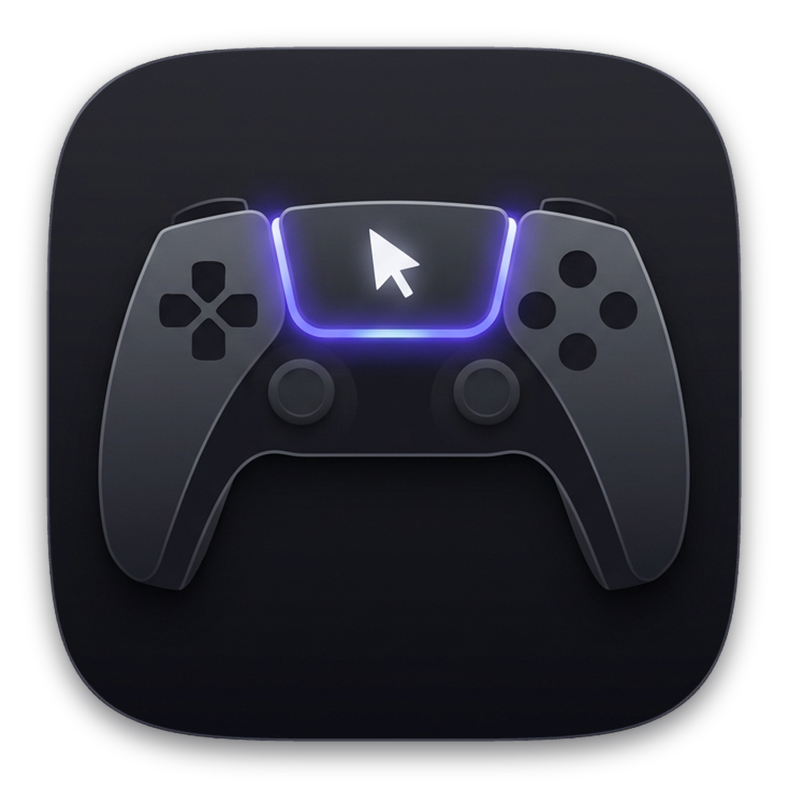

<p align="center">
  
</p>

# PS5 DualSense Couch Control

**Control your entire Windows 10/11 PC ergonomically from your couch using a PS5 DualSense controller — replace your keyboard and mouse for everyday computer use, social media scrolling, YouTube/streaming, web browsing, and voice-to-text.**

---

## Why I Built This (And How Gemini Argon Made It Possible)

I’ve always been a PlayStation couch gamer. When I switched over to PC, the biggest frustration was constantly having to get up or hunch over a keyboard on my lap and fight a mouse that barely works on soft couch cushions just to use my computer, scroll social media, watch videos, or reply to messages.

I’ve always wanted a way to lean back on my couch and control my whole PC natively with a PS5 DualSense controller. **Now, thanks to AI — built entirely with the help of Gemini Argon (in Google Antigravity) — I finally had the ability to bring this idea to life.** Because AI empowered me to build the exact tool I always wished existed, I’m sharing it **100% free and open-source** for everyone to enjoy!

---

## What You Can Do From Your Couch (No Mouse or Keyboard Needed)

- **Full Mouse Replacement (Left Stick & Capacitive Touchpad)** — Glide across your entire Windows desktop at 120 Hz using either the Left Joystick or 1-finger touchpad swipes. Hold **`L2`** for slow Sniper precision (to click tiny buttons) or hold **`R2`** for fast Turbo movement across multi-monitor/4K TV setups.
- **Smooth Social Media & Web Scrolling (Right Joystick)** — Lean back and scroll effortlessly through X (Twitter), Reddit, YouTube, TikTok, articles, and chats using the Right Stick (or 2-finger touchpad swipe).
- **Instant 10-Foot TV Text Zoom (`L2 + Right Stick`)** — Reading small text from the couch? Hold **`L2`** and push the **Right Stick Up/Down** to immediately zoom any web page, social feed, or app in and out (`Ctrl +` / `Ctrl -`).
- **Press Triangle (`△`) to Speak Instead of Typing on a Keyboard** — Ditch the lap keyboard completely. Press **Triangle** (`Win + H`) to dictate messages, search queries, or prompts using your voice, and press **Square (`□`)** to hit Enter / Send. When plugged in via USB-C, it **automatically switches Windows to the PS5 controller's built-in microphone** with a live 24-segment dB meter.
- **Auto 6x Giant TV Cursor + Click-Through Spotlight Halo** — Automatically scales your Windows cursor up (`80px` up to `192px` / 6x) with a glowing spotlight ring so you never lose track of the pointer on a living-room TV — and automatically restores your normal `32px` cursor when you pause or exit.
- **1-Button Screenshots, App Switching & Media Control** — Click the **Touchpad** to view all open Windows programs (`Win + Tab`), tap **Create** for the taskbar or hold it to snap an instant **Screenshot** (`Win + Shift + S`), and block Steam Big Picture Mode from hijacking your **PS Home Button**.

---

## Installation & Quick Start (1-Click Download)

### Option A: Download From [GitHub Releases](https://github.com/dabandpuke/ps5-dualsense-couch-control/releases/latest)
1. Download **`PS5_DualSense_Couch_Control_v1.0.0.zip`** from the **[Latest Release](https://github.com/dabandpuke/ps5-dualsense-couch-control/releases/latest)** page and extract it anywhere.
2. Double-click **`Start Couch Control.bat`** (on first launch, it automatically sets up its virtual environment and dependencies for you!).

### Option B: Clone via Git
1. Clone this repository and open a terminal in the project folder:
   ```powershell
   git clone https://github.com/dabandpuke/ps5-dualsense-couch-control.git
   cd ps5-dualsense-couch-control
   ```
2. Double-click **`Start Couch Control.bat`** (or run `python -m venv .venv`, `.\.venv\Scripts\pip install -r requirements.txt`, and `python app.py`).

### Requirements
- **Windows 10 or Windows 11**
- **Python 3.10+**
- **PS5 DualSense Wireless Controller** (connected via Bluetooth or USB-C)

---

## PS5 Controller Layout

| Button / Stick | Action |
|---|---|
| **Left Stick** *(or Touchpad Swipe)* | Smooth, Precision Mouse Movement *(Hold **L2** = Slow Sniper · Hold **R2** = Fast Turbo)* |
| **Right Stick** *(or 2-Finger Touchpad)* | **Smooth Scroll Social Media, Web Pages, Videos & Chats** · **Hold `L2` + Right Stick Up/Down = Zoom Text (`Ctrl +` / `Ctrl -`)** |
| **Touchpad Press (Click)** | **All Open Programs on One Page (`Win + Tab`)** — Switch between any open app using Arrows or Stick + **✕** |
| **PS Home Button** | **Show / Hide Couch Control Studio** · **Hold `L2 + PS Button` = Cycle Activity Preset** *(Steam Big Picture popup blocked while active)* |
| **Create (Share)** | **Quick Taskbar Access (`Win + T`)** · **Hold (0.4s) = Take Screenshot (`Win + Shift + S`)** · *`L2 + Create` = Show Desktop (`Win + D`)* |
| **D-Pad Arrows (`↑ ↓ ← →`)** | **Navigate Desktop Apps, Taskbar, Open Programs, Menus & Video Timelines** |
| **R1** *(Hold `L2 + R1`)* | **Jump Between Search Boxes / Buttons in Any Window (`Tab` / `Shift + Tab`)** |
| **✕ Cross** *(or Touchpad Tap)* | **Left Click / Drag Select** *(or Opens Highlighted App / Program when navigating with Arrows/Tab)* |
| **△ Triangle** | **Voice-to-Text (`Win + H`)** — Speak into any browser, search bar, chat, or app using the controller mic *(Hold `L2 + △` = Cycle Mic)* |
| **□ Square** | **Send / Enter** · *Hold (0.4s) or `L2 + □` = New Line (`Shift + Enter`)* |
| **○ Circle** | **Right Click** · *Hold (0.45s) = `Escape`* |
| **L1** | **Backspace** *(Hold to repeat)* · *`L2 + L1` = Undo (`Ctrl + Z`)* |
| **Options** | **Show / Hide On-Screen TV Cheat-Sheet HUD** |
| **L2 + Options** | **Pause / Resume (Game Mode)** — Disables desktop mouse control & restores native `32px` cursor size for PC gaming |
| **R3 / L3** | **Switch Microphone (`R3`)** / **On-Screen Keyboard (`L3`)** · *`L2 + L3/R3` = Prev / Next Browser Tab* *(Remappable to Media Play/Pause, Volume, Middle Click, or Fullscreen)* |
| **L2 + Mic Mute Button** | **Mute / Unmute TV Audio** *(Single tap on Mic Mute Button shows hardware orange LED reminder)* |
| **L2 + Right Stick ↑/↓** *(or `L2 + D-Pad ↑/↓`)* | **Zoom Text In / Out (`Ctrl +` / `Ctrl -`)** — Also clickable via **`A-` / `100%` / `A+` / `PLAY` / `VOL` / `MUTE`** in the Studio header |
| **L2 + D-Pad Left / Right** | **Copy (`Ctrl + C`) / Paste (`Ctrl + V`)** |

---

## Activity Control Presets

Switch presets anytime by pressing **`L2 + PS Home Button`** on the controller, clicking a preset in the Left Dock, or selecting from the System Tray menu:

| Activity Preset | Cursor & Speed | △ Triangle | Touchpad Click | Create | L3 / R3 Stick Clicks | Lightbar |
|---|---|---|---|---|---|---|
| **10ft TV & Web Browsing** | `160px` + Halo · `10.5 px/f` | Voice Typing (`Win+H`) | All Open Apps (`Win+Tab`) | Quick Taskbar (`Win+T`) | `L3`: Middle Click (Open/Close Tab) · `R3`: Fullscreen (`F11`) | Cyan |
| **Cinema & Media Remote** | `112px` · `6.5 px/f` | Media Play / Pause | Fullscreen (`F11`) | Mute / Unmute Audio | `L3`: Volume Down · `R3`: Volume Up | Purple |
| **Everyday Desktop & Voice** *(Default)* | `80px` · `7.5 px/f` | Voice Typing (`Win+H`) | All Open Apps (`Win+Tab`) | Quick Taskbar (`Win+T`) | `L3`: On-Screen Keyboard · `R3`: Switch Mic | PS Blue |
| **Precision Desktop & Code** | `64px` · `5.5 px/f` (`0.25x` L2) | Copy (`Ctrl+C`) | All Open Apps (`Win+Tab`) | Screenshot (`Win+Shift+S`) | `L3`: On-Screen Keyboard · `R3`: Paste (`Ctrl+V`) | Emerald |
| **Game Mode (Bypass)** | Native `32px` (Synthesis Paused) | Passed to Game | Passed to Game | Passed to Game | Passed to Game (`L2 + Options` to Resume) | Amber |

---

## Using the Controller's Built-in Microphone vs. Wireless Mic

- **Plugged in via USB-C:** Windows exposes the PS5 controller's built-in microphone (`Wireless Controller`). The app **automatically detects and selects it** as your Windows Default Input Mic.
  - *Tip:* Make sure the small hardware mute button below the PS logo has its **orange light OFF** (orange light ON = hardware muted).
- **Wireless via Bluetooth:** Windows Bluetooth carries controller inputs only (not DualSense audio endpoints), so the app automatically uses your active PC/headset microphone and displays a live dB voice meter.

---

## Running Self-Tests

The application includes an automated non-destructive `--self-test` mode:

```powershell
.\.venv\Scripts\python.exe app.py --self-test
```

---

## Feature Requests & Updates

Built by **[@dabandpuke](https://x.com/dabandpuke)** with the help of **Gemini Argon** — shared 100% free & open-source for everyone to enjoy.
Have an idea for a new controller shortcut, button action, or couch preset?
- **Reply or DM on X:** [@dabandpuke](https://x.com/dabandpuke)
- Or click **`Request Feature (@dabandpuke)`** inside the Couch Control Studio footer!
